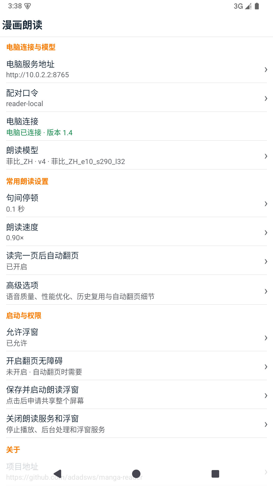
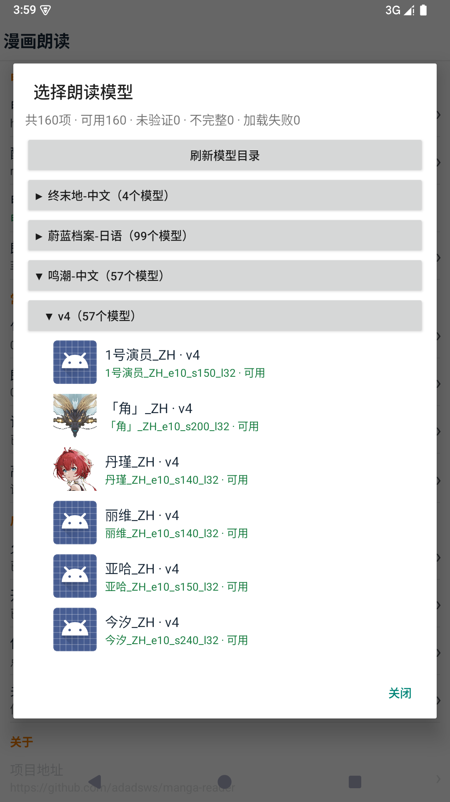

# Manga Reader · GPT-SoVITS

[简体中文](README.md) · [English](README_EN.md)


Open a manga on Android and tap the floating control to read its text in panel order. Reader can turn the page when playback finishes. You can select a compatible GPT-SoVITS voice model and adjust speech speed and pauses.

## How it works

- Android captures the screen, displays the floating control, plays audio, and optionally turns pages.
- The Windows computer runs RapidOCR for text recognition, Magi v2 for panel layout and reading order, and GPT-SoVITS for speech. When speech completeness checks are enabled, ASR checks the generated audio.

Models and the main processing run on the computer. Screenshots and audio travel between the two devices over the local network; the processing does not require a cloud service.

## Models

- RapidOCR (PP-OCRv6) uses small detection and medium recognition models for whole-page text. Remaining mistakes can be corrected in the text editor.
- Magi v2 detects panels and text regions. Text is assigned to panels, then ordered by recursive whitespace partitions within each panel.
- GPT-SoVITS uses Wuthering Waves `菲比_ZH` by default. You can select another compatible voice in the Android app. A model needs GPT `.ckpt`, SoVITS `.pth`, and reference audio, and is marked available only after it loads and passes a reference audio trial.

When the computer service starts, it loads and trials complete models that have not yet been verified, reusing previous successful results. The Android model list keeps each folder's actual status, shows verification progress, and refreshes when the batch finishes. A failed trial shows the model's error.

## Preview

[Video example: floating control](https://www.bilibili.com/video/BV1ooan6iEgm/)

| Connection and settings | Select a character |
|---|---|
|  |  |
| Page turning settings | Floating control |
|  | <br><audio controls preload="metadata" src="https://raw.githubusercontent.com/adadsws/manga-reader-gpt-sovits/main/docs/readme-assets/reading-preview.wav"></audio><br>[Listen to or download this page read by 菲比_ZH](https://raw.githubusercontent.com/adadsws/manga-reader-gpt-sovits/main/docs/readme-assets/reading-preview.wav) |

## First-time setup

You need a Windows computer with an NVIDIA GPU. Set the paths for your computer in `config/runtime.json`, `config/reader.json`, and `config/tts.yaml`, then run these commands from the project directory:

```powershell
python tools/download_mingchao_zh.py --only 菲比_ZH
python tools/prepare_mingchao_profiles.py --only 菲比_ZH
powershell -NoProfile -ExecutionPolicy Bypass -File tools/prepare_runtime.ps1
python tools/prepare_layout.py
```

The first two commands prepare the default `菲比_ZH` model, its reference prompt audio, and a local avatar. Existing model files are verified without being overwritten. The other commands prepare the runtime and layout model. See the [Wuthering Waves model guide](models/gpt-sovits/鸣潮-中文.md) and [Magi model guide](models/layout/magiv2.md) for sources and rebuilding.

## Option 1: Android Emulator

This project uses the official Google Android Emulator. For initial setup, run:

```powershell
python tools/prepare_android.py
python tools/prepare_avd.py
python tools/build_android.py
```

Afterward, double-click [启动电脑服务和安卓模拟器.bat](启动电脑服务和安卓模拟器.bat) and wait for the app to show that the computer is connected with protocol version 1.4. You can drag manga images into the emulator. The launcher moves the emulator window into the current display's usable area and scales it down proportionally when necessary.

Double-clicking [仅启动安卓模拟器.bat](仅启动安卓模拟器.bat) stops only a computer service that this project's launcher can identify as its own. The Android app should then show that the computer is disconnected.

## Option 2: Physical Android device

1. Connect the computer and phone to the same Wi-Fi network. Avoid guest networks.
2. Send [reader.apk](reader.apk) to the phone and install it. Use this same file for updates.
3. Double-click [仅启动电脑服务.bat](仅启动电脑服务.bat).
4. Enter the connection address and pairing token shown on the computer into the Android app, and wait for the connection status.

Physical device support is still being refined. If something fails, first try the emulator to confirm that the computer service works.

The computer Reader service and Android app both default to port `8765`. An APK built on this computer uses its LAN IP at build time (for example, `192.168.3.209`) as the physical phone default; the official emulator automatically uses `10.0.2.2:8765`. If the computer changes networks or IP, enter the new address shown by the desktop launcher in Android's computer address setting, or rebuild the APK on the current network. The internal speech service on `9882` is not the Android connection address.

## Start reading

The steps are the same on the emulator and a physical device:

1. Select a voice and adjust speech settings.
2. Tap `1 允许浮窗` and grant the floating window permission in Android settings.
3. To enable automatic page turning, tap `2 开启翻页无障碍`, select `漫画朗读`, and allow full device control. Skip this for manual page turning.
4. Tap `3 保存并启动朗读浮窗` and confirm full-screen sharing. On Android 14 and later, Reader explicitly requests the entire screen.
5. Open a manga and tap `▶ 重新开始` on the floating control.

The floating window and accessibility permissions normally need to be granted only once. Screen sharing must be confirmed when reading starts.

With automatic page turning enabled, a page with no recognized text leads directly to a page-turn attempt. If the image does not change, Reader stops instead of retrying forever.

The advanced history option uses the latest non-hidden result for an exact match. Disable `匹配历史结果时跳过处理` to process the page again. When `隐藏本次记录` is enabled, the new result is saved but skipped by later history matches. The pairing token is displayed as entered in the settings list and edit box; avoid saving a real token on an untrusted device.

## Troubleshooting

- Connection fails: check Wi-Fi, the connection address, and the pairing token. Disable guest network or device isolation.
- Yellow version warning: the Android and computer protocol versions differ, but reading can continue. Update the older side when convenient. Older Android clients that do not report a version also produce a warning.
- Incorrect or missing text: enlarge the manga and restart reading. Unusual fonts, very small text, and complex panels can still cause recognition errors.
- Speech fails: tap `查看完整错误` on the floating control and check the computer window.
- Stop the computer service: run `仅启动电脑服务.bat stop` from the project directory.

[Change log](CHANGELOG.md)
